# Parqueadero USTA

Proyecto integrador de **Desarrollo Orientado a Servicios 2026-2** — Universidad Santo Tomás, Tunja.

Sistema web que muestra en tiempo real cuántos cupos libres hay en cada zona del parqueadero y registra las entradas y salidas de los vehículos.

## El problema

Hoy nadie sabe si hay cupos disponibles. Algunos usuarios llegan a la portería y los devuelven por falta de espacio, lo que causa filas, rechazos y pérdida de tiempo.

**Usuarios:** docentes, directivas, estudiantes y vigilantes de portería.
**Datos que maneja:** vehículos, zonas del parqueadero y registros de entrada y salida.

## Tecnologías

| Parte | Herramienta |
|---|---|
| Lenguaje | Java 21 |
| Framework | Quarkus 3.38 |
| Base de datos | MySQL (XAMPP) con Hibernate ORM / Panache |
| Vistas | Qute + Bootstrap 5 + Bootstrap Icons |
| Reportes | OpenPDF |
| Documentación de la API | Swagger UI (SmallRye OpenAPI) |
| Arquitectura | Hexagonal (puertos y adaptadores) |

Convención: los identificadores van en inglés; los comentarios y los mensajes al usuario, en español.

## Requisitos

- JDK 21
- XAMPP con el módulo **MySQL** encendido (puerto 3306)
- Git
- No hace falta instalar Maven: el proyecto incluye `mvnw`

## Cómo ejecutarlo

1. Abre XAMPP y enciende **MySQL**.
2. Clona el proyecto y entra a la carpeta:
   ```bash
   git clone https://github.com/daimersonAvila/Parqueadero-USTA.git
   cd Parqueadero-USTA
   ```
3. Inicia la aplicación en modo desarrollo:
   ```bash
   ./mvnw quarkus:dev        # en Windows: .\mvnw quarkus:dev
   ```
4. Abre http://localhost:8080 en el navegador.

   Si todo salió bien, verás la pantalla de disponibilidad con los cupos de cada zona:

   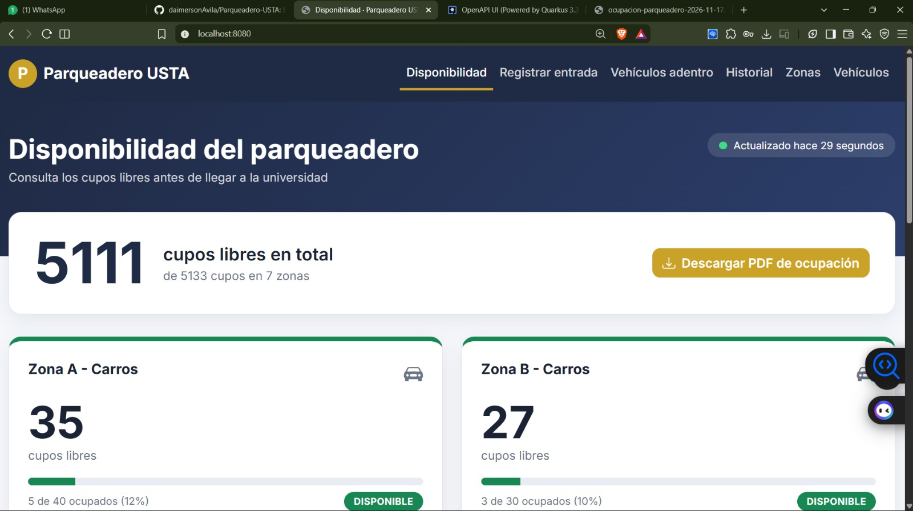

La base de datos `parqueadero` se crea sola la primera vez y las tablas se actualizan automáticamente. Al arrancar, el `DataSeeder` carga datos de ejemplo (4 zonas, vehículos y registros) solo si la base está vacía, así que reiniciar no duplica nada.

La conexión usa el usuario `root` sin contraseña, que es la configuración por defecto de XAMPP. Está en `src/main/resources/application.properties`.

## Pantallas

| Ruta | Pantalla | Qué permite |
|---|---|---|
| `/` | Disponibilidad | Ver los cupos libres de cada zona y el total del parqueadero |
| `/entry` | Registrar entrada | Ingresar una placa y elegir la zona; permite registrar un vehículo nuevo al momento |
| `/inside` | Vehículos adentro | Listar, buscar por placa o zona y registrar la salida con un clic |
| `/history` | Historial y reportes | Consultar los registros por rango de fechas y zona, con resumen y descarga de PDF |
| `/zones` | Zonas | Crear, editar, abrir y cerrar zonas |
| `/vehicles` | Vehículos | Registrar, editar y buscar vehículos por placa |

### Disponibilidad (`/`)

Pantalla principal. Muestra el total de cupos libres, una tarjeta por zona con su barra de ocupación y su estado (Disponible, Pocos cupos o Llena), y el botón para descargar el PDF de ocupación.


### Registrar entrada (`/entry`)

El vigilante escribe la placa y elige la zona. Si la placa todavía no existe, activa **Vehículo nuevo** y completa los datos del propietario en el mismo paso. A la derecha se ven los cupos de la zona seleccionada.

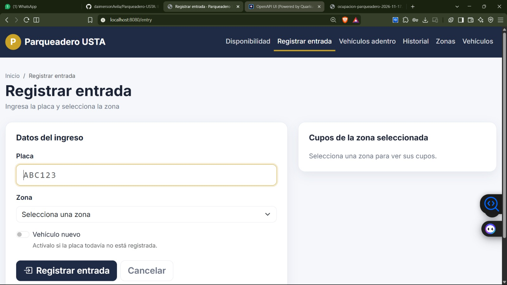

### Vehículos adentro (`/inside`)

Lista los vehículos que están en el parqueadero, con su zona, hora de entrada y permanencia. Se puede buscar por placa o zona, descargar el PDF y registrar la salida con un clic.

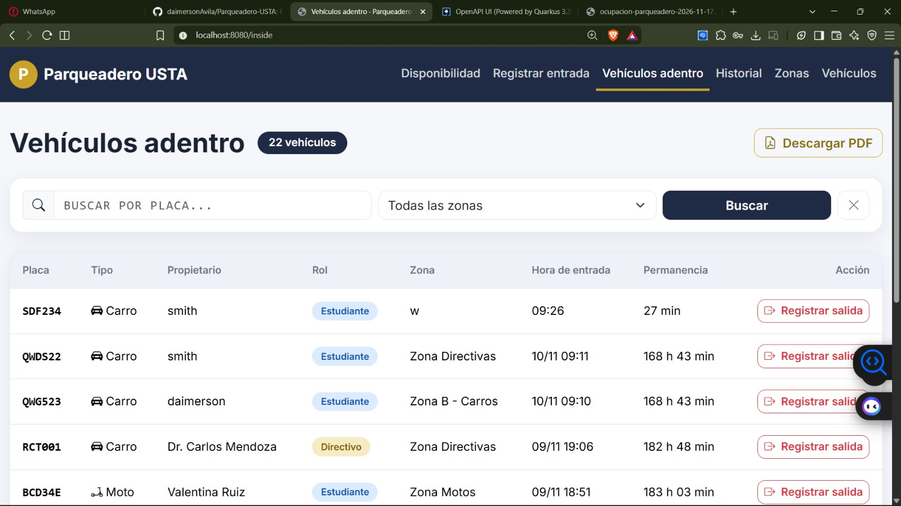

### Historial y reportes (`/history`)

Consulta de registros por rango de fechas y zona (por defecto, los últimos 7 días), con tres datos de resumen (registros, vehículos adentro y permanencia promedio) y los botones de descarga de PDF.

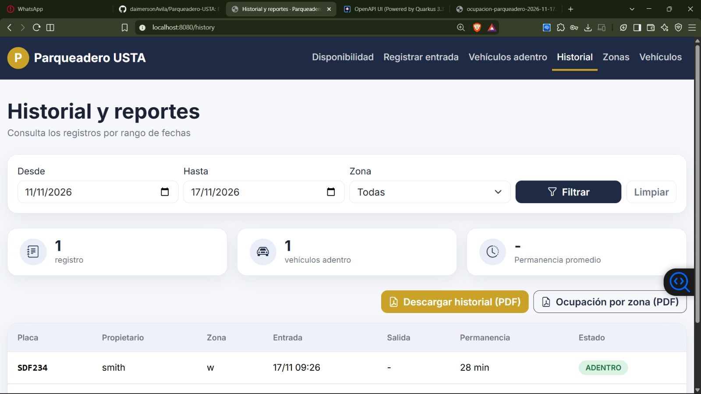

### Zonas (`/zones`)

Tabla con la capacidad y los vehículos ocupados de cada zona. El interruptor abre o cierra la zona; el lápiz la edita en el formulario de la derecha y el formulario también sirve para crear zonas nuevas.

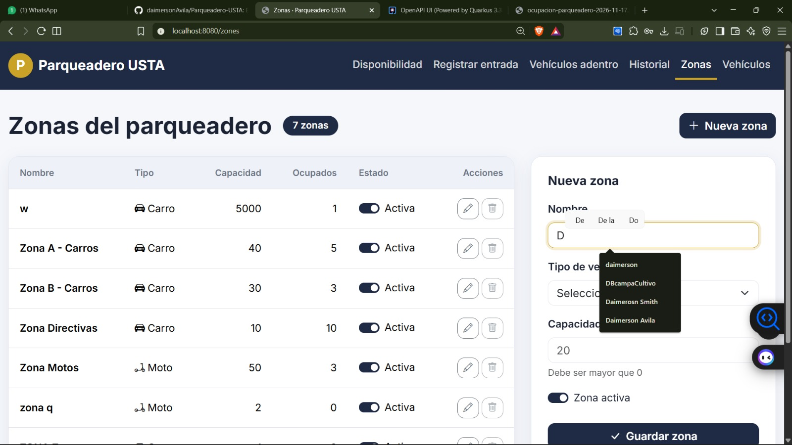

### Vehículos (`/vehicles`)

Vehículos registrados con búsqueda por placa y paginación. El formulario de la derecha permite registrar uno nuevo o editar el seleccionado con el lápiz.

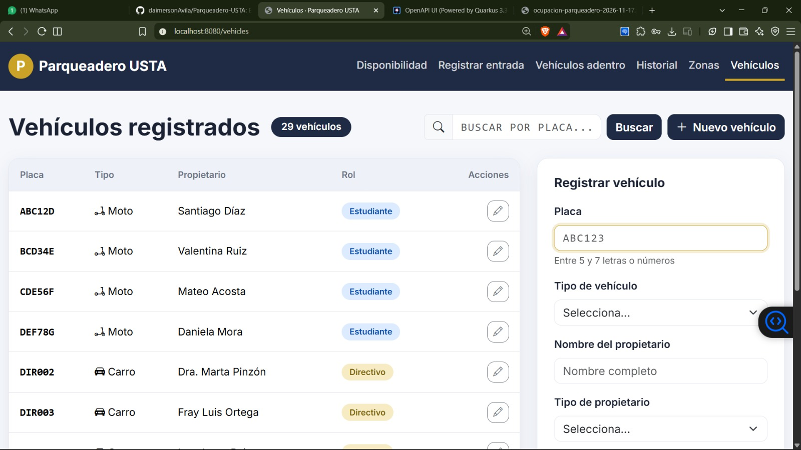

### Reportes en PDF

| Ruta | Contenido |
|---|---|
| `/reports/occupancy` | Ocupación por zona |
| `/reports/inside` | Vehículos que están adentro (acepta `plate` y `zoneId`) |
| `/reports/history` | Historial entre dos fechas (`from`, `to` en formato `yyyy-MM-dd`, y `zoneId` opcional). Si no se envían fechas, usa los últimos 7 días |

**Ocupación por zona**

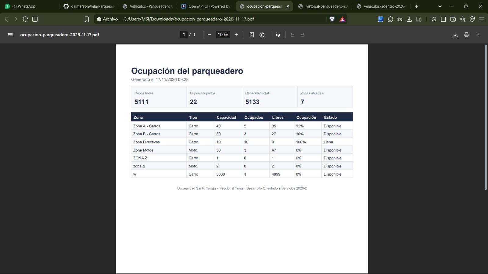

**Vehículos dentro del parqueadero**

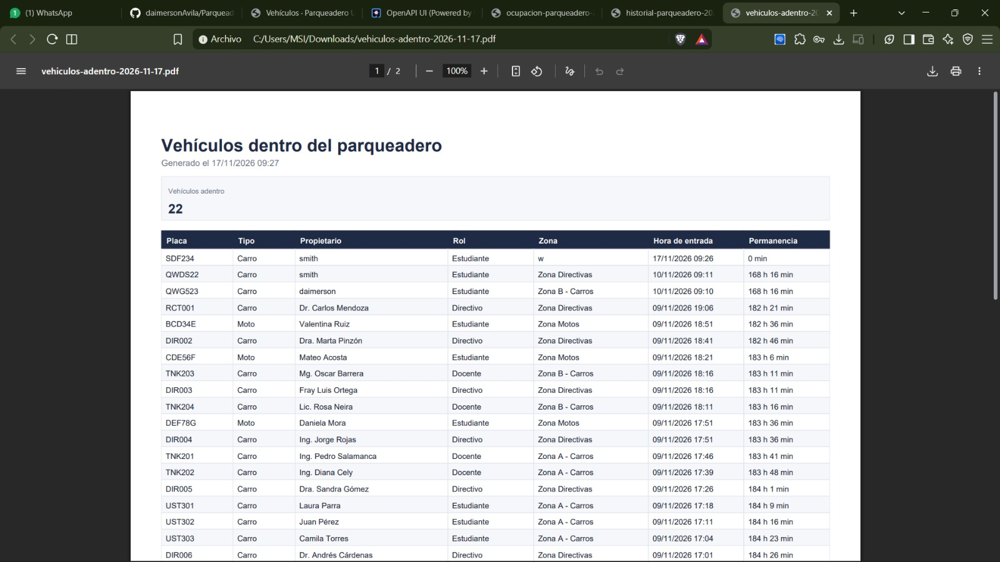

**Historial de entradas y salidas**

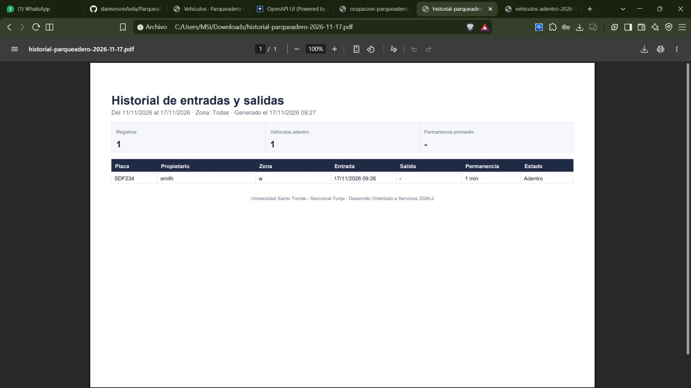

## Reglas de negocio

| Código | Regla |
|---|---|
| RN-01 | Cupos libres = capacidad − vehículos adentro (nunca negativo). Una zona cerrada no ofrece cupos |
| RN-02 | Un vehículo no puede estar dos veces adentro al mismo tiempo |
| RN-03 | No se puede ingresar a una zona cerrada ni a una zona llena |
| RN-04 | El tipo de vehículo debe coincidir con el tipo de la zona (carro con carro, moto con moto) |
| RN-05 | La placa se guarda en mayúsculas, sin espacios ni guiones, con 5 a 7 letras o números |
| RN-06 | La permanencia se calcula desde la entrada hasta la salida (o hasta ahora si sigue adentro) |
| RN-07 | La capacidad de una zona debe ser mayor que 0 y no se puede bajar por debajo de los vehículos que hay adentro |
| RN-08 | Estado de la zona: **Disponible**, **Pocos cupos** (10 % o menos de cupos libres) o **Llena** |

## Arquitectura

El proyecto sigue la arquitectura hexagonal. Todas las dependencias apuntan hacia el dominio.

```
src/main/java/usta/parking/
├── domain/                        Núcleo: modelo y reglas de negocio (sin framework)
│   ├── model/                     Vehicle, ParkingZone, ParkingRecord y enums
│   ├── service/                   Reglas (ParkingRulesService, AvailabilityService)
│   └── exception/                 BusinessRuleException
├── application/                   Casos de uso
│   ├── port/in/                   Lo que la aplicación ofrece (interfaces de casos de uso)
│   ├── port/out/                  Lo que la aplicación necesita (repositorios)
│   ├── usecase/                   Implementación de los casos de uso
│   └── exception/                 ResourceNotFoundException
├── config/                        DataSeeder (datos de ejemplo)
└── infrastructure/adapter/
    ├── in/web/                    Única entrada: vistas HTML
    │   ├── resource/              Rutas (Index, Entry, Inside, History, Zones, Vehicles, Report)
    │   ├── dto/                   Datos que se envían a las plantillas
    │   ├── mapper/                Conversión entre dominio y vistas
    │   └── report/                Generación de los PDF
    └── out/persistence/           JPA + MySQL (entity, repository, adapter, mapper)

src/main/resources/
├── templates/                     Plantillas Qute (base, entry, inside, history, zones, vehicles)
└── META-INF/resources/            CSS y JavaScript
```

**Regla de arquitectura:** `domain/` y `application/` no importan `jakarta.persistence`, Qute ni Quarkus.

## Documentación de la API (Swagger)

Con la aplicación encendida:

- Swagger UI: http://localhost:8080/q/swagger-ui
- Especificación OpenAPI: http://localhost:8080/q/openapi

Las rutas aparecen agrupadas por pantalla: Disponibilidad, Entradas, Vehículos adentro, Historial, Zonas, Vehículos y Reportes.

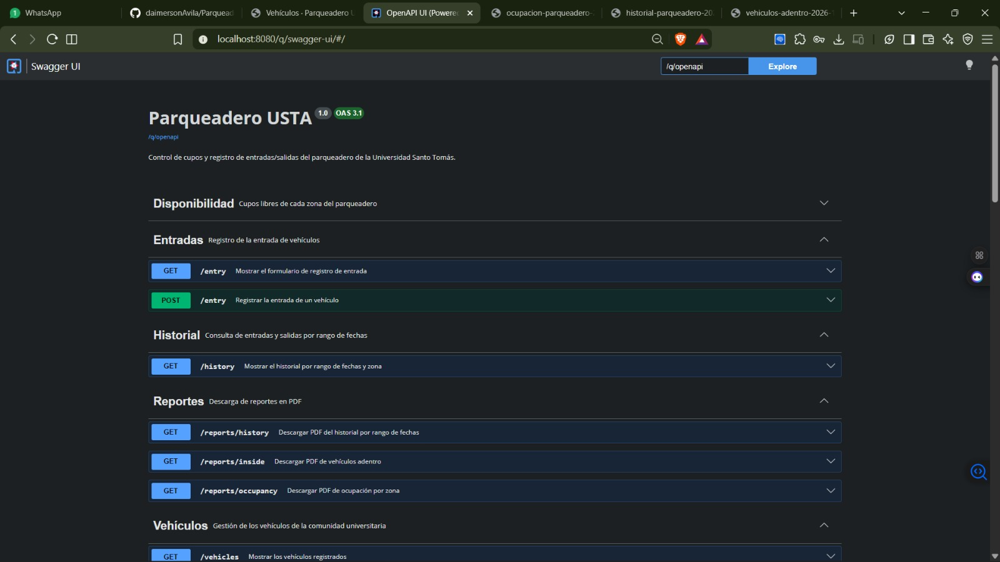

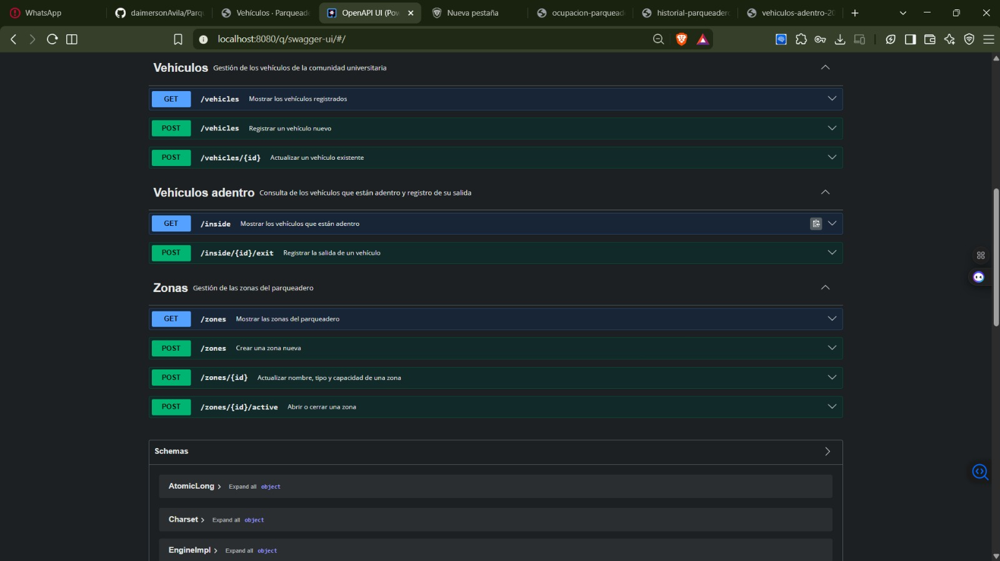

## Base de datos

Tablas principales: `vehicle`, `parking_zone` y `parking_record` (cada registro enlaza un vehículo con una zona, con hora de entrada, hora de salida y estado `ACTIVE` o `FINISHED`).

Las consultas usadas para verificar los datos desde phpMyAdmin están en `docs/evidencias/phpmyadmin/consultas.sql`.

## Trabajo en equipo

- Nadie hace `push` directo a `main`: todo entra por Pull Request.
- Cada persona trabaja en su propia rama (`feature/usecases`, `feature/persistence`, `feature/web-core`, `feature/web-management`) y en sus propias carpetas.
- Antes de abrir un Pull Request, el proyecto debe compilar con `./mvnw compile`.
- Nunca se usa `git push --force`.
- `pom.xml` y `application.properties` los modifica solo la persona 5 o el dueño del repositorio.

## Equipo

| Persona | Responsabilidad |
|---|---|
| 1 | Dominio y puertos |
| 2 | Casos de uso y reportes PDF |
| 3 | Persistencia y datos de ejemplo |
| 4 | Plantilla base, Disponibilidad, Registrar entrada y Vehículos adentro |
| 5 | Historial, Zonas, Vehículos, Swagger y README |
